  <picture>
    <source media="(prefers-color-scheme: dark)" srcset="./assets/banner-dark.svg" />
    <source media="(prefers-color-scheme: light)" srcset="./assets/banner-light.svg" />
    
  </picture>

  

    
    
    
    
    
  

## About

Software Development student at **TARUMT** (Tunku Abdul Rahman University of Management and Technology). I build software end to end: typed React front ends, concurrency-safe .NET APIs, computer-vision models, and desktop automation that removes manual data entry from real business workflows.

| Area | What I work on |
| :--- | :--- |
| **Full-Stack Web & Mobile** | React 19 + TypeScript PWAs with offline support, role-based routing, and Capacitor builds for Android and iOS |
| **Backend Systems** | ASP.NET Core 8 APIs with EF Core, serializable transactions, and xUnit-tested concurrency control |
| **Applied AI** | Object detection with YOLOv8, RT-DETR, and Faster R-CNN; Gemini-powered features in production apps |
| **Process Automation** | Playwright + OCR pipelines that extract, verify, and report legal and court data to Excel |

## Selected Work

| Project | Summary | Stack |
| :--- | :--- | :--- |
| [**ParkJom**](https://github.com/ChunJIA614/ParkJom-Frontend) | Smart transit-parking platform for the Klang Valley. Commuter, owner, and admin consoles with live maps, SignalR updates, and IoT health views. | `React 19` `TypeScript` `Capacitor 8` `SignalR` `Leaflet` |
| [**Slot Reservation API**](https://github.com/ChunJIA614/Mini-Slot-Reservation-Alert-API) | Reservation service that prevents double-booking via per-slot async locks, serializable SQLite transactions, and a unique-index backstop. 28 xUnit + 14 frontend tests. | `C#` `ASP.NET Core 8` `EF Core` `SQLite` `xUnit` |
| [**DormMate**](https://github.com/ChunJIA614/DormMate) | Household grocery and bill-splitting PWA with real-time Firestore sync, offline persistence, FCM push, and AI grocery parsing. | `React 19` `Firestore` `Workbox` `Gemma 3` |
| [**Zapfan Smart Cashier**](https://github.com/ChunJIA614/zapfan) | Computer-vision cashier that prices mixed-rice plates. Benchmarked three detectors; deployed RT-DETR at 0.96 mAP@50. | `Python` `PyTorch` `Ultralytics` `Streamlit` |
| [**C-PRO Case Suite**](https://github.com/ChunJIA614/cpro-case-suite) | Desktop tool that extracts case data from legal PDFs and automates multi-account status checks on a bank law-firm portal. | `Python` `Playwright` `RapidOCR` `PyMuPDF` |
| [**Makan Apa?**](https://github.com/ChunJIA614/makan-apa_) · [live](https://makanapa-8f2e2.web.app) | Location-based restaurant finder PWA with Gemini recommendations and offline caching. | `React` `Firebase` `Gemini` `PWA` |

<b>More repositories</b>

 

| Project | Summary | Stack |
| :--- | :--- | :--- |
| [**EFS Scraper**](https://github.com/ChunJIA614/efs_scrapper) | Extracts filings and fees from Malaysia's court e-filing system into print-ready Excel reports. | `Python` `Playwright` `openpyxl` |
| [**UniMerge Timetable**](https://github.com/ChunJIA614/unimerge-timetable) | Merges several people's class schedules into one grid with clash detection and PDF export. | `React` `TypeScript` `jsPDF` |
| [**CodeNection 2025**](https://github.com/ChunJIA614/codenection2025-frontend-kumpulanfreerider) | Hackathon build: student mental-health app with mood tracking, diary, and community feed. | `React` `Tailwind CSS` |
| [**Lucky Cat BaZi Oracle**](https://github.com/ChunJIA614/fortune_cat) | Gemini-powered BaZi fortune-reading web app. | `TypeScript` `Vite` `Gemini` |

## Tech Stack

<table>
  <tr>
    <td width="170"><b>Languages</b></td>
    <td>
      <picture>
        <source media="(prefers-color-scheme: light)" srcset="https://skillicons.dev/icons?i=ts,js,cs,python,c,html,css&theme=light" />
        
      </picture>
    </td>
  </tr>
  <tr>
    <td><b>Frontend & Mobile</b></td>
    <td>
      <picture>
        <source media="(prefers-color-scheme: light)" srcset="https://skillicons.dev/icons?i=react,vite,tailwind,androidstudio&theme=light" />
        
      </picture>
      &nbsp;
      
    </td>
  </tr>
  <tr>
    <td><b>Backend & Data</b></td>
    <td>
      <picture>
        <source media="(prefers-color-scheme: light)" srcset="https://skillicons.dev/icons?i=dotnet,nodejs,firebase,sqlite&theme=light" />
        
      </picture>
      &nbsp;
      
    </td>
  </tr>
  <tr>
    <td><b>AI & Automation</b></td>
    <td>
      <picture>
        <source media="(prefers-color-scheme: light)" srcset="https://skillicons.dev/icons?i=pytorch&theme=light" />
        
      </picture>
      &nbsp;
      
      
      
    </td>
  </tr>
  <tr>
    <td><b>Tooling</b></td>
    <td>
      <picture>
        <source media="(prefers-color-scheme: light)" srcset="https://skillicons.dev/icons?i=git,github,vscode,figma&theme=light" />
        
      </picture>
    </td>
  </tr>
</table>

## GitHub Analytics

  <picture>
    <source media="(prefers-color-scheme: dark)" srcset="https://github-readme-stats.vercel.app/api?username=ChunJIA614&show_icons=true&hide=stars&hide_rank=true&include_all_commits=true&card_width=420&bg_color=0d1117&border_color=30363d&title_color=58a6ff&icon_color=58a6ff&text_color=c9d1d9" />
    <source media="(prefers-color-scheme: light)" srcset="https://github-readme-stats.vercel.app/api?username=ChunJIA614&show_icons=true&hide=stars&hide_rank=true&include_all_commits=true&card_width=420&bg_color=ffffff&border_color=d0d7de&title_color=0969da&icon_color=0969da&text_color=1f2328" />
    
  </picture>
  <picture>
    <source media="(prefers-color-scheme: dark)" srcset="https://github-readme-stats.vercel.app/api/top-langs/?username=ChunJIA614&layout=compact&langs_count=6&card_width=360&bg_color=0d1117&border_color=30363d&title_color=58a6ff&text_color=c9d1d9" />
    <source media="(prefers-color-scheme: light)" srcset="https://github-readme-stats.vercel.app/api/top-langs/?username=ChunJIA614&layout=compact&langs_count=6&card_width=360&bg_color=ffffff&border_color=d0d7de&title_color=0969da&text_color=1f2328" />
    
  </picture>
   
  <picture>
    <source media="(prefers-color-scheme: dark)" srcset="https://github-readme-activity-graph.vercel.app/graph?username=ChunJIA614&bg_color=0d1117&color=8b949e&line=58a6ff&point=f0f6fc&area=true&area_color=58a6ff&hide_border=false&custom_title=Contribution%20activity" />
    <source media="(prefers-color-scheme: light)" srcset="https://github-readme-activity-graph.vercel.app/graph?username=ChunJIA614&bg_color=ffffff&color=57606a&line=0969da&point=1f2328&area=true&area_color=0969da&hide_border=false&custom_title=Contribution%20activity" />
    
  </picture>

 

  Thanks for visiting. Feel free to explore the repositories above.

